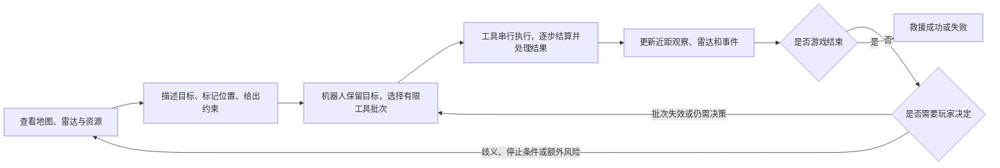
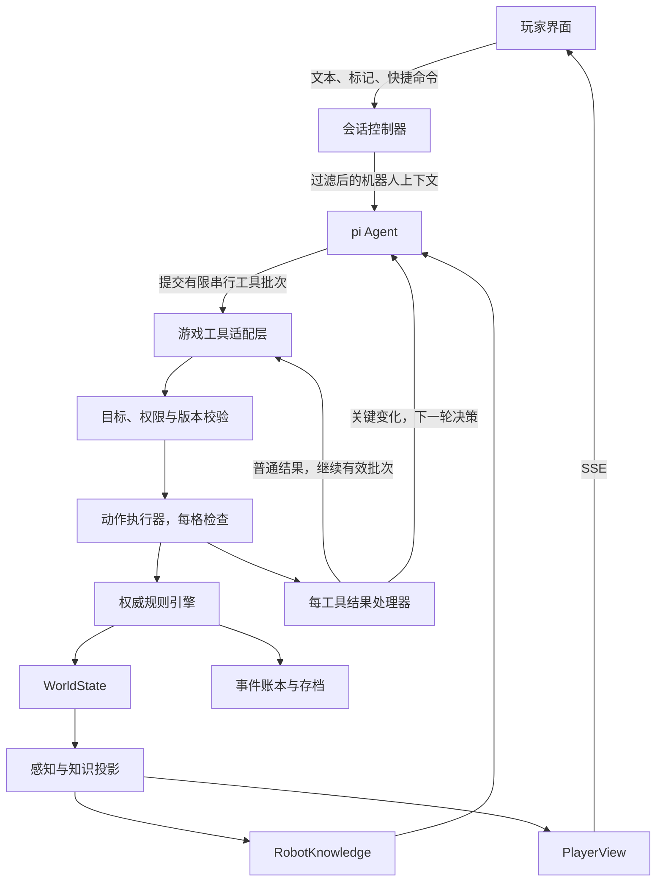
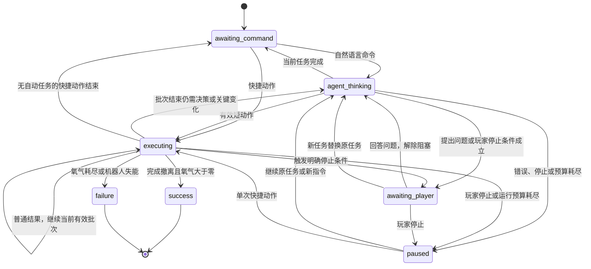

# AI 队友探险游戏开发文档

> 工作名：《最后一段氧气》；名称尚未确定。
>
> 文档版本：0.10｜日期：2026-10-12｜状态：原型、真实模型配置、pi 凭据复用、对话内授权按钮、可手动操作的实体电路开关已实现，线上模型及玩家试玩待验收。
>
> 本文用于指导个人项目开发。已确认的设定与建议采用的默认规则分别列出；所有数值均为原型参数，需通过试玩调整。

## 1. 项目概述

玩家是一名在空间站事故中受伤的人类，暂时无法自行移动，依靠有限氧气维持生命。唯一能够行动的伙伴是一台电量有限的机器人。

玩家通过平面网格地图、雷达和自然语言对话指挥机器人。机器人依靠小范围传感器识别附近物体、探索路线、取得补给、维修设备，最终把玩家带到撤离气闸。

游戏的核心体验是信息互补：玩家看得远，但无法识别回波的具体内容；机器人看得近，但能准确识别传感器范围内的对象。成功依赖双方沟通、路径选择和资源管理。

### 1.1 已确认的设定

- 地图采用实际存在坐标和距离的二维网格，支持 N×M，不要求正方形。
- 玩家是人类，受氧气限制。
- AI 队友是机器人，受电量限制。
- 玩家开局受伤、暂时无法移动，通过对话指挥机器人。
- 机器人可以向玩家反馈观察、状态和任务进展。
- 机器人传感器范围较小，但能准确识别附近可感知的内容。
- 玩家能够通过雷达观察机器人附近更大范围的信号，但无法直接得知具体对象。

### 1.2 首个原型采用的默认规则

- 单人、单机器人、单关卡，科幻事故救援题材。
- 四方向移动，无斜向移动。
- 游戏时间由动作推进，输入、阅读和模型请求不消耗游戏时间。
- 玩家开局掌握事故前的空间站布局，实时设施状态可能与旧地图不同。
- 雷达中心跟随机器人，玩家与机器人保持通信；首版不模拟通信距离和断线。
- 机器人能够搬运玩家；恢复自主移动属于后续扩展。
- 关卡和物资固定，随机地图属于后续扩展。
- 首版完成修复撤离通路、搬运玩家、通过气闸撤离的完整闭环。

### 1.3 产品目标

- 玩家至少经历一次“雷达发现异常 → 告知机器人 → 近距确认 → 调整计划”的决策。
- 至少两条可通向撤离区域的路线，具有不同的时间、电量和操作成本。
- 玩家能通过自然语言表达目标、约束和停止条件。
- 机器人行动和反馈能够改变玩家的判断，且结果可追溯到实际规则。
- 首局现实游玩时长目标为 10～15 分钟，不对应固定游戏时间单位。
- 成败由已执行的行动决定，模型响应速度不影响生存资源。

## 2. 核心循环与局内流程

### 2.1 核心循环



玩家输入明确指令后，机器人保持任务目标，通过“决策 → 串行工具 → 逐工具处理观察 → 必要时再决策”连续推进。一个模型响应允许多个基于已知目标的工具调用。工具结果之间的普通变化由程序处理；足以让后续调用失效的新信息中断批次并交回模型，重大选择再询问玩家。

路线和行动设想是可修订的工作记录。只预先执行能够明确校验的有限工具批次，不能把未知设施的成功、未发现物品的身份或尚未取得的授权作为既定事实。

### 2.2 一局游戏的阶段

| 阶段 | 玩家目标 | 机器人主要行动 | 主要决策 |
|---|---|---|---|
| 初始评估 | 判断资源和撤离位置 | 报告电量、扫描起点 | 先延长供氧还是探路 |
| 探索准备 | 获取足够的路线与设施信息 | 搜查、近距检查、寻找补给 | 是否为补给绕路 |
| 打通撤离路线 | 解决门锁或危险区域 | 维修门锁、清理障碍、搬运物资 | 走短而危险的路线还是长路线 |
| 接回玩家 | 准备搬运撤离 | 返回、修补供氧、抱起玩家 | 是否先带回额外电池 |
| 负重撤离 | 在资源耗尽前到达气闸 | 搬运、沿已知路线行进、启动撤离 | 是否绕行，是否执行备用计划 |
| 结算 | 理解成功或失败原因 | 输出事实记录 | 哪个决策造成主要资源消耗 |

阶段是任务引导，不是强制线性脚本。允许直接探路、提前维修、跳过补给等合法策略。

## 3. 地图与空间规则

### 3.1 坐标和移动

- 原型地图尺寸：12×12；后续支持配置任意尺寸。
- 原点位于左上角，x 向右增加，y 向下增加。
- 合法坐标：`0 <= x < width`，`0 <= y < height`。
- 距离采用曼哈顿距离：`|x1 - x2| + |y1 - y2|`。
- 每次基础移动只进入一个上下左右相邻格。
- 墙、未开启的门、未清理的障碍不可通行。
- 默认不允许机器人与其他实体重叠；物品、危险、玩家和气闸可使用专门的共格规则。
- 机器人可与受伤玩家共格，才能抱起玩家；搬运后人类位置随机器人同步更新。
- 地图视觉可采用房间和走廊美术，无须显示棋盘线；调试模式显示坐标和格线。

交互距离统一采用同格或曼哈顿距离 1 格，且需要可见、无隔墙。抱起玩家和启动撤离必须同格。物资、玩家和气闸允许共格；柜体、障碍和墙不可站入，需从相邻格操作。

### 3.2 地图分层

| 层 | 内容 | 是否随游戏变化 |
|---|---|---|
| 地形 | 墙、地面、房间、走廊 | 首版不变 |
| 设施 | 门、开关、气闸、充电柜 | 可以改变状态 |
| 实体 | 玩家、机器人、物资、障碍 | 可以移动、取得或移除 |
| 危险 | 漏电、水洼、干扰源 | 依电路和交互改变 |
| 历史布局 | 事故前地图和房间名称 | 固定参考资料 |
| 观察记录 | 已发现对象、雷达信号、时间戳 | 随行动更新 |

“旧地图上有一扇门”不代表门现在能开启。历史布局与实时观察必须在显示和数据上区分。

### 3.3 寻路

- 使用四方向 A* 或 BFS，步数相同时采用稳定的方向顺序，保证回放一致。
- 自动寻路只读取机器人已知地形、历史布局和已观察到的阻挡状态。
- 未检查过的历史可通行格可以作为候选路线，但必须标记为状态未验证。
- 禁止利用真实世界中尚未观察到的障碍、危险或补给优化路线。
- 未知故障直到进入传感器范围或尝试动作才被发现；此时中断当前短动作，将观察返回 Agent 重新决策。玩家要求发现即停，或处理需要额外授权时，才暂停等待玩家。
- “没有已知路线”不能自动解释成“真实地图无路可走”。
- 自动寻路默认避开已知危险；主动进入危险需要玩家明确授权。

## 4. 信息系统与双视野

### 4.1 三份信息状态

游戏维护三份逻辑上独立的数据：

1. `WorldState`：实际地图、实体、设施和资源的权威状态，仅服务端领域模块读取，由规则引擎写入。
2. `PlayerKnowledge`：历史布局、雷达观察、机器人已向玩家报告的事实、玩家标记。
3. `RobotKnowledge`：历史布局、机器人直接观察、玩家主动传达的信息、已验证结果。

机器人 Agent 不接收整个 `WorldState` 或 `PlayerKnowledge`。前端也不接收完整隐藏实体表，只接收玩家视图。

### 4.2 机器人近距传感器

- 被动感知半径默认 1 格，采用曼哈顿距离，并受墙和关闭的门遮挡。
- 同格和有视线的相邻格可以识别对象类型、数量、位置和显著外观。
- 不透墙识别对象，不自动读取密封箱内部，不远程判断电池剩余容量。
- 主动扫描不增加首版识别半径；用于检查近处对象的内部状态、线路故障和可交互方式。
- 每次移动或有效交互后更新被动观察，不额外消耗扫描电量。
- 新出现的近距观察记录包含来源、坐标和游戏时间。
- “精准识别”表示规则提供的观察可靠；隐藏属性仍需相应的扫描或交互。

示例：被动观察能识别“电池柜”；扫描可以确认“柜门锁定，需要辅助电路供电”；打开柜子后才能确认里面电池的状态。

### 4.3 玩家雷达

- 雷达中心是机器人当前位置，默认半径 5 格，采用曼哈顿距离。
- 首版能够穿透普通隔墙探测回波；地图边界外不产生信号。
- 雷达设备由玩家的救援终端供电，首版不另设电量，也不消耗机器人的电量。
- 每个已提交动作之后更新雷达；暂停对话期间保持上一份结果。
- 只提供回波位置、粗略强度、信号形态和观察时间，不提供对象类型、内部 ID 或互动选项。
- 同格多个实体合并为一个回波，不能通过回波数量直接推断物品数量。
- 离开探测范围的记录变为历史观察，显示为淡色并附最后观察时间。

| 信号形态 | 固定规则 | 玩家可作出的推测 |
|---|---|---|
| 稳定弱回波 | 低反射对象 | 可能是小物件或小型结构 |
| 稳定强回波 | 高反射对象或多对象叠加 | 可能是大型金属结构 |
| 闪烁回波 | 受通电故障或干扰影响 | 值得让机器人检查电气风险 |

多个对象类型可以产生相同信号，不能建立“某种回波必然等于电池”的一一对应关系。首版信号确定性生成，不采用每次随机变化的假回波。

### 4.4 信息传递

- 玩家说“右前方有强回波”后，这句话进入机器人的通信记录，来源标记为玩家描述。
- 玩家点击“发送标记”后，机器人收到坐标、玩家备注和雷达信号摘要，不收到真实对象类型。
- 仅在玩家自己地图上做标记不会自动发送；发送按钮与本地标记视觉上区分。
- 机器人附近的信息不会直接全量显示为玩家地图上的精确对象；通过确定性的观察报告事件共享。
- 新发现、危险、阻挡和目标物品由程序生成简短事实报告，保证模型故障时玩家仍能获得必要信息。
- AI 可以补充措辞和建议，但不能把未知对象描述成已经确认的事实。
- 氧气、电量、负重和当前位置属于共同遥测信息，双方可以读取。

### 4.5 不确定性表达

机器人区分“观察”“转述”“推测”：

- 观察：“我看到一只锁定的电池柜。”
- 转述：“你标记的位置有强回波，具体对象尚未确认。”
- 推测：“根据旧地图，那可能在维修区；需要靠近确认。”

推测不写入已确认对象表。旧观察保留时间戳，设施状态改变后更新相关已知记录，避免把过期事实当成实时事实。

## 5. 游戏时间与资源结算

### 5.1 时间单位

采用离散游戏时间单位 `TU`。TU 是行动成本，不是现实秒数；动画播放速度不改变 TU。

输入、阅读、查看地图、拖动标记、模型思考、网络请求和暂停均消耗 0 TU。

移动、扫描、维修、开门、搬运、切换电路和启动撤离消耗指定 TU。机器人与玩家共用一条游戏时间线，首版所有有效动作串行执行。

### 5.2 原型默认参数

| 参数 | 初始值／默认值 | 说明 |
|---|---|---|
| 人类氧气 | 120 | 无量纲资源单位 |
| 氧气上限 | 180 | 补给不能超过上限 |
| 初始氧气消耗率 | 2／TU | 供氧管受损 |
| 修补后氧气消耗率 | 1／TU | 需一次性维修材料 |
| 机器人初始电量 | 90 | 两条救援路线经实际规则验证后采用的原型值 |
| 机器人电量上限 | 100 | 电池补给不能超过上限 |
| 备用电池 | +30 | 单次物资，用后移除 |
| 氧气补给 | +40 | 单次物资，用后移除 |
| 机器人额外物品槽 | 2 | 搬运人类不占物品槽 |
| 单次移动工具上限 | 12 个基础移动 | 每格检查，关键变化立即中断；同时受剩余 TU 预算限制 |
| 单轮工具批次上限 | 6 个工具调用 | 串行执行，每个调用前后校验和处理结果 |
| 单次任务运行模型预算 | 8 次请求 | 到上限暂停，目标保留，可继续决策 |
| 单次任务运行行动预算 | 12 TU | 单个动作开始前检查，不能跨过预算 |

氧气消耗为 `行动开始时的消耗率 × 动作 TU`。修补供氧结束后降低消耗率，不追溯改变该次维修消耗。

### 5.3 基础动作成本

| 动作 | TU | 电量 | 条件与结果 |
|---|---:|---:|---|
| 空载移动一格 | 1 | 1 | 相邻格合法可通行 |
| 搬运玩家移动一格 | 1 | 2 | 人类位置随机器人更新 |
| 主动扫描 | 1 | 2 | 检查同格或可见相邻格的目标 |
| 打开普通可用门 | 1 | 1 | 门邻接、未锁定、所需电路有效 |
| 取得／放下物资 | 1 | 1 | 物资可达，容量允许 |
| 安装备用电池 | 1 | 1 | 先扣除动作电量，成功后增加 30 |
| 为玩家补充氧气 | 2 | 2 | 玩家附近，有氧气补给 |
| 修补玩家供氧管 | 6 | 4 | 玩家附近，有维修材料 |
| 维修气闸控制器 | 4 | 4 | 控制器附近，有维修材料 |
| 清理普通障碍 | 3 | 4 | 障碍邻接，未超过搬运能力 |
| 抱起玩家 | 1 | 2 | 同格，未在搬运 |
| 放下玩家 | 1 | 1 | 同格地面合法且无危险 |
| 机器人切换电路 | 1 | 0 | 已识别实体开关，在同格或相邻格且视线可及 |
| 启动撤离 | 2 | 2 | 搬运玩家位于出口，气闸已修复 |

维修材料是统一的消耗品；每次修补或维修消耗一份。关卡至少提供两份，允许同时修补供氧和维修气闸。

机器人切换电路也会消耗氧气。玩家可对话指挥、批准 AI 操作，或在机器人靠近后直接点击前端“附近操作”按钮；搬运期间机器人仍须靠近实体开关。手动切换按相同规则结算并暂停当前任务。

### 5.4 动作原子性和失败

每个基础动作按以下顺序处理：

1. 校验请求身份、会话状态、坐标、对象已知性、合法交互范围和玩家约束。
2. 计算时间、电量和危险附加成本，检查机器人是否有足够电量开始动作。
3. 扣除 TU 对应的氧气、电量和附加损耗；游戏时间增加。
4. 如果氧气已耗尽，进入失败，不应用该动作的正向效果。
5. 应用移动、维修、取得物资等效果，更新设施和人类位置。
6. 更新传感器、雷达、观察记录和事件。
7. 检查撤离成功，再检查机器人电量耗尽。
8. 写入事件与资源账本，提交状态版本，发布玩家视图。

非法参数、重复请求和已知前置条件不成立：拒绝，不推进时间，不扣资源。

由于尚未检查的设施属性而发生的有效尝试失败，消耗尝试成本。例如对外观正常但内部卡死的门执行开门，消耗 1 TU、1 电量，门保持关闭，得到“开门失败、原因待扫描”的事实并返回 Agent。是否继续扫描或询问玩家，依据任务约束判断。

普通邻接障碍应由被动传感器提前发现；已知不可通行格不执行移动。若后续加入会移动的障碍，动作开始时重新校验，再为真实发生的受阻尝试定义成本。

引擎不得以“目标 ID 不存在”等错误泄露远处隐藏对象。对象型交互只能引用机器人已知且当前可达的目标。

### 5.5 资源耗尽边界

- 氧气 `<= 0`：人类死亡，立即失败，优先于撤离成功。
- 电量不足以支付动作基础成本：动作不开始，返回资源不足结果。若已有授权的补给动作可以解决，Agent 可重新选择；否则等待玩家。
- 动作结束后电量 `<= 0` 且尚未成功撤离：机器人失去行动能力，首版判为失败。
- 启动撤离后氧气仍大于 0，即使该动作恰好用尽电量，也算成功，气闸接管救援。
- 最后一点电量可以用于安装电池，只要动作完成后电量因补给回升。
- 首版不允许玩家远程复活已耗尽电量的机器人。

### 5.6 风险与预警

- 资源条显示当前值、最大值和最近动作消耗。
- 氧气低于初始值的 30% 或机器人电量低于上限的 20% 时，首次触发预警。
- 指令指定“保留返回电量”时，使用已知路线估算返回成本，并预留至少 5 电量；估算受未知地图影响，需显示这一点。
- 引擎在每个基础动作前重新评估约束；不满足则阻止该动作并返回结果。Agent 可以选择满足约束的替代动作，但不能放宽约束；没有合法替代时等待玩家。
- 返回目标默认是玩家当前所在位置，搬运开始后该约束改为撤离目标的已知路线成本。
- 首版不把资源预测包装成保证成功的承诺。

## 6. 危险、设施和物资

### 6.1 首版两类危险

| 危险 | 探测线索 | 已确认效果 | 处理方式 |
|---|---|---|---|
| 通电漏电区 | 雷达可能闪烁；近距识别暴露导线 | 进入该格额外损失 6 电量 | 指挥机器人靠近开关断电，或明确授权绕行／穿越 |
| 碎片障碍区 | 常见强回波；近距识别碎片堆 | 不可通行 | 清理消耗时间电量，或寻找替代路径 |

发现危险立即中断当前移动。未指定“发现危险就停”时，机器人可以在已有任务范围内选择不进入危险的替代路线；跨越危险、消耗额外稀缺物资或修改任务优先级需要玩家已有授权或新的决定。首版不增加独立机器人生命值或战斗系统。

### 6.2 电路联动

关卡设一条可切换的辅助电路，连接电池柜、电动门和漏电区。实体开关位于设备间 (6,1)，机器人须先近距识别，再走到同格或相邻格操作；开关格可通行。靠近后前端“附近操作”显示开关按钮，AI 也可调用开关工具，未知开关位置不会直接加入机器人知识。

- 电路关闭：漏电区无额外损耗；电池柜不能打开。
- 电路开启：电池柜可以打开；漏电区带电。
- 电路状态改变会更新观察和雷达信号，但不会把玩家尚不知道的电器位置直接揭示出来。
- 机器人可以报告已观察到的联动；未知连接需要扫描设备后才能确认。
- 开关操作来自玩家界面，通过同一规则引擎结算。

这是首版的主要协作谜题：玩家决定通断电时机和路线，机器人须走到开关位置执行并确认后果，再取得物资。

### 6.3 补给与交互

- 维修材料、备用电池和氧气瓶均为有限物资。
- 物品需要先被机器人识别，再取得；雷达回波不能作为直接取物目标。
- 电池安装在机器人身上；氧气补给和供氧修补需要接近人类。
- 物品取得后写入背包，地图上的原物品移除。
- 补给按实际恢复量显示，超过上限的部分损失，不能反复领取。
- 密封柜的内容只有打开后可知，不从工具名称、对象 ID 或预览文本提前透露。

## 7. 对话与机器人行为

### 7.1 指令表达

一条指令可以包含以下信息：

| 信息 | 示例 | 处理方式 |
|---|---|---|
| 目标 | “检查右侧设备间” | 转换为已知房间或坐标 |
| 优先级 | “先拿电池，再回来” | 保存任务顺序，具体动作随观察调整 |
| 约束 | “保留返回电量” | 引擎逐动作检查 |
| 停止条件 | “遇到漏电就停” | 新观察触发暂停 |
| 风险授权 | “允许穿过这段已确认的漏电区” | 对应具体危险和计划，不能无限扩展 |

“先想办法保证我活着”这类宽泛指令可以得到建议，但首版不授予无限自动探索权限。机器人提出具体目标，等待玩家选择或给出更明确目标。

任务约束由会话控制器保存，重决策不能放宽它们。普通移动、为已指定对象扫描、按指令取物属于任务默认范围；危险穿越、指令之外的维修材料消耗、丢弃物资和修改任务优先级不自动获得授权。

### 7.2 歧义处理

- “那边”“那个东西”不能确定目标时，询问一个简短问题，不执行移动。
- “右边”默认指地图右侧，即 x 增大；如指相对机器人方向，必须明确。首版不模拟朝向。
- 有多个匹配对象时，列出已知坐标或名称供选择。
- 无法确定目标类型时，可以靠近查看；不能假定它是补给。
- 无法执行的目标，报告已知原因并建议一个可行下一步。

### 7.3 执行中观察与重新决策

机器人保留目标和约束，在同一个 ReAct 运行中允许一轮提出多个工具调用，按顺序执行。每个工具完成后，程序先处理实际结果、区分新旧观察、校验剩余调用，然后决定继续批次还是中断。移动工具最多走 12 格，但每格都检查环境和玩家输入，不等整段走完才观察。

| 新情况 | 处理层 | 后续行为 |
|---|---|---|
| 普通空地、信息无实质变化 | 动作执行器与结果处理器 | 继续当前工具和有效的后续调用，无须插入模型请求 |
| 发现与当前目标无关的普通设备 | 结果处理器 | 存入知识，记录增量，不强制重决策 |
| 已知路线被堵、出现未知任务目标或扫描推翻后续前提 | 结果处理器与 Agent | 中断批次，用新观察选择扫描、取物或替代路线 |
| 发现漏电但存在已知安全路线 | Agent | 未被玩家要求停下时，可以在约束内绕行 |
| 玩家要求“发现危险就停” | 会话控制器 | 进入等待玩家状态，不能自行绕行后继续 |
| 需要玩家通电、危险授权或额外稀缺物资 | Agent 与会话控制器 | 报告事实和选项，等待决定 |
| 电量储备约束无法满足，或没有已知安全路线 | 会话控制器与 Agent | 阻止动作，报告资源或路线问题 |
| 玩家停止、改令，或游戏结束 | 会话控制器 | 取消未提交动作和旧决策 |

“中断工具并重新决策”不等于“暂停等待玩家”。普通变化允许机器人自行适应，重大选择保留给玩家。

每次玩家命令启动一个有限 ReAct 运行，默认最多 8 次模型请求、12 TU 的自动行动。一轮允许最多 6 个工具调用，避免固定“一工具一请求”。整个运行预算耗尽后保留目标和观察，等待玩家继续；达到目标、需要询问或玩家停止时可以提前结束。

ReAct 是模型与工具交替的运行方式，不表示整个循环只有一次模型请求。若要让模型读完结果再生成新的工具参数，仍需要下一次推理；减少请求依靠有效批次、较长但可中断的移动，以及程序处理普通变化。

连续两轮都没有执行动作、取得有效新观察、完成任务等任何实质进展，且未提出需要玩家回答的问题，视为无进展，暂停并显示原因，避免重复查询和空转。普通地图格被动观察不算新的关键发现。

### 7.4 反馈设计

机器人只在以下事件报告：

- 新发现目标物资、未知设施或危险。
- 当前动作受阻、准备改变路线，或实际成本与预估明显不同。
- 玩家设定的停止条件成立。
- 资源预警、任务阶段完成、撤离结束。
- 玩家主动查询状态。

报告先说事实，再给选项。例如：“门锁损坏，直接开门失败。我可以使用一份维修材料修复，预计 4 TU、4 电量；也可以沿东侧走廊绕行。”

普通移动由动画和行动日志表达。角色语气可靠、简短，可带轻微个性；个性不能覆盖观察真实性、约束或停止条件。

### 7.5 玩家停止和改令

- 停止按钮立即使当前短动作尚未执行的部分和后续 Agent 决策失效。
- 已提交的基础动作保留结果，不倒扣资源；进行中的动画只表现已提交动作。
- 新指令替换旧任务，使用新的 `commandRevision`。
- 旧模型响应、旧路径和旧网络事件不得在新指令下继续执行。
- “先停止”在模型仍响应时直接中止该运行，保证快捷按钮不依赖语言理解。

## 8. 首个关卡设计

### 8.1 布局要求

首关为 12×12 网格，包含四个主要区域：事故舱、维修区、设备间和撤离气闸。

| 区域 | 主要内容 | 设计目的 |
|---|---|---|
| 事故舱 | 受伤玩家、邻近机器人、救援终端 | 明确目标和双资源 |
| 维修区 | 两份维修材料、氧气瓶 | 提供稳定供氧与任务维修选择 |
| 设备间 | 电池柜、联动电路 | 展示模糊回波与近距检查 |
| 撤离通路 | 漏电短路、障碍长路、损坏气闸控制器 | 路线取舍与救援结局 |

机器人与玩家开局相邻。关键物品放在实际可到达区域；玩家起点和气闸相距约 14～18 格，具体位置由关卡编辑时确定。

### 8.2 路线与平衡要求

- 存在两条从事故舱到气闸区域的候选路径。
- 短路线受电路漏电影响；长路线需要绕行或清理障碍。
- 气闸必须先修复控制器，再启动撤离。
- 至少一种胜利路线不依赖模型猜出未观察到的物品位置。
- 教学不强制取得每件补给；允许玩家跳过供氧修补，用更短路线承担资源压力。
- 最优已知路线应保留一定余量；错误路线会明显消耗资源，但一次普通失误不应必然失败。
- 在关卡制作阶段，用确定性脚本计算至少两条完整胜利路线的资源账本，再调整初始参数。

### 8.3 首次引导

1. 显示受伤状态、氧气泄漏和撤离目标。
2. 机器人主动报告电量和近处可见情况。
3. 雷达突出一个机器人尚未识别的回波，提示发送标记。
4. 玩家给出探索指令，机器人根据新发现自主扫描；需要玩家通电时报告并等待。
5. 展示继续、停止和资源预测，此后允许自由规划。

### 8.4 示例流程

玩家发现设备间有强回波，让机器人靠近。机器人识别锁定电池柜，扫描后确认需要辅助电路。机器人继续搜索并找到实体开关，靠近后提出通电工具调用；玩家点击批准，机器人操作开关，雷达上的走廊出现闪烁信号。机器人取得电池、打开电动门后，在开关旁断电，再经安全走廊前往气闸。之后机器人修好气闸，返回抱起玩家，经安全路线撤离。

该流程是可行策略示例，不作为唯一通关脚本；能否成功必须由实际路线和资源成本计算。

## 9. 界面与交互

### 9.1 主界面

桌面浏览器优先，默认三栏布局：

- 左侧：氧气、电量、当前目标、背包和电路状态；机器人靠近开关后，在“附近操作”直接切换电路。
- 中央：平面地图、机器人位置、玩家位置、已报告对象、雷达覆盖与回波。
- 右侧：通信记录、输入框、当前任务、下一步意图与事件摘要。
- 地图底部：继续、停止、返回玩家、报告状态四个快捷操作。

### 9.2 地图表现

- 历史布局采用暗色线框；已确认区域采用较清晰填充。
- 回波使用形状、亮度和闪烁表达；不使用电池、敌人等身份图标。
- 机器人报告的对象使用明确图标和名称。
- 历史观察变淡，并提供最后更新时间。
- 玩家本地标记与已发送标记采用不同边框。
- 选择格子后显示坐标、已知信息及信息来源；不显示隐藏实体属性。
- 路线预览区分已验证路径和未检查路径。
- 资源和危险状态同时采用文字、形状及颜色，不仅依赖红绿颜色。

### 9.3 对话表现

- 玩家信息、机器人对话、系统事实报告和动作结果视觉区分。
- 流式输出可以显示，但未完成的句子不能触发游戏动作。
- 每个工具调用通过完整参数和当前前置条件校验后才执行；批次中断时后续调用显示为未执行。
- 行动摘要显示长期任务、当前动作、路线、约束和估算成本，明确路线可能调整。
- 等待模型时显示“机器人正在理解指令”或“机器人正在根据新发现调整行动”，并明确资源暂停。
- 模型不可用时显示原因、重试和快捷指令；已确认事实仍可查询。

### 9.4 结算

成功：显示撤离时间 TU、剩余氧气、电量、使用物资和主要路线。

失败：显示直接原因、最后几个有效动作以及对应的资源消耗。不得把模型超时、网络断开或输入等待算成游戏失败。

首版不设复杂评分；先保证结局可解释。

## 10. 技术方案

### 10.1 推荐技术栈

| 层 | 原型建议 | 选择原因 |
|---|---|---|
| 前端 | TypeScript、原生 DOM、esbuild | 当前复用本地已有工具，无新增依赖；React/Vite 保留为后续选择 |
| 地图绘制 | Canvas 2D | 小网格无需额外游戏引擎 |
| 后端 | Node.js 24.4+、原生 TypeScript、Node HTTP | 当前直接运行 TypeScript 服务端，与本地 pi 构建产物衔接 |
| Agent | `@earendil-works/pi-agent-core` | 工具调用、对话运行和流式事件 |
| 模型接入 | `@earendil-works/pi-ai` | 统一模型提供方与请求能力 |
| 通信 | HTTP 命令 + SSE 事件 | 单人原型足够，易实现重连 |
| 存储 | 本地 JSON 快照与事件记录 | 首版不引入数据库 |
| 校验 | TypeBox 与显式领域校验 | Schema 校验和游戏合法性校验分开 |

应用已创建于 `D:/pi/ai-teammate-game`，当前复用相邻 `pi-main` 的编译器、打包器及 agent/ai 构建产物，没有修改 pi 源码或安装新依赖。未来需要更复杂动画时可以替换为 PixiJS 或 Phaser，领域规则不绑定渲染器。

### 10.2 项目组织

游戏作为独立项目放在 `D:/pi/ai-teammate-game`，复用 pi 包，不在 pi 源码内部添加游戏规则。

```text
ai-teammate-game/
  apps/
    web/src/
      map/                   # 地图和雷达渲染
      communication/         # 对话、任务和事实报告
      hud/                   # 资源、背包、快捷操作
    server/src/
      sessions/              # 会话、命令版本和串行执行
      agent/                 # pi 接入、上下文和工具
      transport/             # HTTP、SSE 和视图投影
      persistence/           # 快照和事件存储
  packages/
    game-core/src/
      rules/                 # 原子动作、资源和结局
      perception/            # 传感器、雷达和知识投影
      navigation/            # 基于已知地图的寻路
      tasks/                 # 任务目标、约束和重新决策条件
      skills/                # 有限动作执行与逐格观察
      tool-results/          # 新旧观察差分、去重和批次中断
      types/                 # 领域数据结构
  content/levels/            # 关卡定义和原型参数
  tests/                     # 规则、集成和固定场景
  docs/                      # 开发文档与试玩记录
```

上图是目标模块划分；当前原型采用较少文件：`engine.ts`、`navigation.ts`、`level.ts`、`types.ts`、`session.ts`、`model.ts`、`server.ts` 和 `main.ts`。复用的 agent 与 ai 来自同一套本地构建产物；后续再按复杂度拆分模块和固化独立依赖。

### 10.3 数据流与边界



只有规则引擎写入世界状态。Agent 负责理解任务、选择有限批次、随关键观察调整策略和措辞，不直接设置坐标、氧气、电量或结局。目标保持在会话控制器中，每个工具结果先交由程序处理，再决定批次能否继续。

## 11. pi-agent 接入规范

### 11.1 本地 API 基线

本文依据本地 `pi-main/packages/agent` 文档与类型，包名是 `@earendil-works/pi-agent-core`，本地版本为 1.1.0。实现时以实际安装版本的类型为准。

- `Agent`：每个游戏会话一个实例。
- `initialState`：初始化角色提示、模型、工具和必要通信历史。
- `streamFn`：使用 `pi-ai` 提供的模型流函数。
- `subscribe()`：订阅消息、工具和运行事件。
- `prepareRequest`：每次模型请求前安装最新、过滤后的机器人上下文。
- `transformContext`：必要时裁剪旧对话；保留工具调用与结果配对。
- `beforeToolCall`：校验命令版本、批次状态、当前前置条件和预算，阻止已失效的剩余调用。
- `afterToolCall`：处理增量观察、压缩模型可见结果，并记录是否需要中断批次。
- `finishTurn`：根据任务进展决定继续闭环还是暂停，不在每次工具调用后固定结束。
- `abort()`：用于取消旧模型运行，不代替短动作执行器的取消检查。

`Agent.state.messages` 是通信上下文，不等同于游戏存档；持久化由本项目实现。首版不依赖 coding-agent 的文件操作工具或 CLI。

### 11.2 上下文组成

按以下顺序提供机器人模型上下文：

1. 角色身份、可靠反馈原则和允许动作。
2. 共同遥测：氧气、电量、人类位置、机器人位置、负重。
3. 机器人已知布局、已确认对象与观察时间。
4. 玩家已发送的雷达标记和描述，明确来源及不确定性。
5. 当前任务、玩家约束、下一步意图、未解决问题和最近工具执行结果。
6. 最近几轮对话。

不能加入未发送雷达数据、隐藏物资表、未观察设施状态或关卡标准答案。调试真值另走调试接口，禁止进入生产提示或工具结果。

长对话摘要只概括已发生通信；精确坐标、约束和设施状态从结构化知识重新生成，不依赖模型回忆。

### 11.3 工具设计

工具在同一个 ReAct 运行中串行执行。每个工具完成后立即经过应用结果处理器；模型在批次结束或被中断后的下一轮读取处理过的结果。取消固定“每轮只接受一个工具”的限制，允许一轮最多 6 个调用。

同一响应里的调用由模型预先生成，串行执行期间并没有再次调用模型。程序可以依据新观察阻止后续操作、维护知识和执行已定义的局部规则，但不能声称模型已经看过中途结果并作出新推理。

| 工具 | 输入 | 输出 | 对游戏时间的影响 |
|---|---|---|---|
| `get_status` | 可选查询范围 | 当前遥测、机器人已知对象与最近结果 | 0 TU |
| `move_to` | 坐标、`maxSteps`（1～12） | 实际路径、是否到达、中断原因、观察增量、成本 | 按实际已执行格数结算 |
| `scan` | 当前可见对象 ID | 精确检查结果、新的交互条件和成本 | 1 TU、2 电量 |
| `interact` | 操作枚举、目标 ID、可选物品 ID | 操作是否成功、实际变化、新观察、成本 | 按基础动作成本表 |
| `set_circuit` | 已知开关 `targetId`、布尔值 `on` | 实际电路状态、附近观察差分、成本 | 1 TU、0 电量；机器人须同格或邻接，通电必要时先按钮授权 |
| `report` | 已有观察引用、简短说明 | 面向玩家的事实报告 | 0 TU；可继续决策 |
| `ask_player` | 问题、已知事实引用、可选选项 | 问题事件，任务转为等待玩家 | 0 TU；结束本次自动运行 |
| `finish_task` | 结束原因、已有结果引用 | 当前任务完成或无法继续的记录 | 0 TU；结束本次自动运行 |

`interact.operation` 限定为 `open`、`collect`、`drop_item`、`use_item`、`repair`、`clear`、`pickup_human`、`drop_human` 和 `extract`。`drop_item` 补充对应“放下物资”的动作；目标和物品必须是机器人已知且当前可交互的对象。

`finish_task` 结束的是本次任务委托，不是游戏本身。完成撤离和游戏胜负只能由领域规则判断；“无法继续”保留原始目标和问题供玩家修改指令。可程序验证的任务目标必须先检查完成条件，不能仅因模型说完成而成立。

#### 11.3.1 每格观察与中断

`move_to` 是可中断的有限移动，内部流程为：

```text
选择基于已知地图的下一格
→ 校验任务、状态和资源
→ 提交一格移动
→ 更新传感器与玩家雷达
→ 仅根据机器人可得的信息判断变化是否影响任务或后续调用
→ 有关键变化：立即返回实际结果，标记批次失效
→ 无变化且未到上限：继续下一格
```

返回时可能只走了 1 格，剩余格数不执行，也不留作后续队列。若没有关键变化，可以连续走到目标或上限，中途不会因重复看到旧物品而请求模型。需要调整目标或策略时，由下一轮模型重新发起工具。

例：机器人从 `(2,5)` 向 `(7,5)` 移动，在 `(3,5)` 识别相邻的锁定柜子，即刻返回：

```json
{
  "status": "interrupted",
  "batchControl": "redecide",
  "reason": "key_discovery",
  "position": { "x": 3, "y": 5 },
  "targetReached": false,
  "executedSteps": 1,
  "cost": { "tu": 1, "battery": 1, "oxygen": 2 },
  "newDiscoveries": [
    {
      "id": "obs-12",
      "entityId": "known-cabinet-07",
      "position": { "x": 4, "y": 5 },
      "type": "cabinet",
      "visibleState": "locked",
      "source": "sensor"
    }
  ],
  "stateChanges": [],
  "invalidatedFacts": [],
  "knownRefs": []
}
```

发现此前未知、与找电池任务有关的柜子时，程序先中断批次，下一轮 Agent 可决定扫描。扫描发现需要玩家通电时，再等待配合。对于原本已知的柜子，可以预先批量提出“移动到柜旁 → 扫描 → 开柜”，但扫描结果若推翻开柜前提，就必须阻止开柜；对于开柜后才知道的电池 ID，不能预先编造取物调用。

只有机器人传感器、已发送雷达标记和共同遥测影响其重决策。玩家独有的未发送雷达变化不传给机器人，也不能作为自动选路的隐藏依据。

#### 11.3.2 工具结果协议

所有动作结果包含实际完成内容、公开遥测增量、资源消耗、状态版本，以及以下彼此区分的观察字段：

| 字段 | 含义 | 示例 |
|---|---|---|
| `newDiscoveries` | 此工具首次确认的对象或信息 | 第一次识别电池柜 |
| `stateChanges` | 已知对象属性的变化或新检查结果 | 柜门从关闭变为开启，扫描确认供电要求 |
| `invalidatedFacts` | 已不成立的旧事实引用 | 电池已取得，“电池仍在地面”失效 |
| `knownRefs` | 再次观察到但内容未变的旧信息引用 | 返回途中再次经过同一柜子 |

每个工具比较“该工具执行前的机器人知识”与“该工具执行后的观察”，不能始终与本轮开始的知识比较。工具 A 已发现的物品，在工具 B 中再次看到应归入 `knownRefs`，不能再算新发现。同一实体的新属性归入 `stateChanges`，不重复创建对象。

结果处理顺序：规范化观察 → 用实体与属性标识去重 → 更新 `RobotKnowledge` → 记录事实来源与时间 → 判断对剩余调用的影响 → 写入批次账本 → 生成简短模型可见 `content` 与玩家事件。

每个工具开始前保存只读的知识快照或版本。逐格感知层可以先更新即时知识，用于移动中的危险检查；工具结束时处理器比较开始快照和最新知识，不把已经更新的知识误当成执行前状态。合并操作应幂等，不能再次插入逐格层已记录的事实。

完整观察保存在游戏知识和事件账本；模型结果主要携带新发现、变化、失效事实、必要资源差量和少量旧信息引用。未变化对象的完整说明不在每个工具结果中重复发送。

批次另维护 `pendingModelDelta`，汇总本轮至今尚未向模型传达的变化；两个工具更新同一属性时，保留最终值和必要的因果事件。下一轮统一安装知识摘要与增量，不能因每工具去重而遗漏模型尚未看过的事实。

`pendingModelDelta` 是内部汇总，不默认再把逐工具 `content` 已携带的全部事实复制进系统提示。每条新事实在本次请求中选择一个主要承载位置，避免工具结果、知识摘要和汇总增量三次重复。`knownRefs` 只列与当前调用有关的少量引用，不重复列出附近所有旧物品。较老对话按完整调用与结果组裁剪，精确已知状态保存在结构化知识中。

- `batchControl: continue`：剩余调用的目标、前提与约束仍有效，可以串行继续，不插入模型请求。
- `batchControl: redecide`：当前批次已失效，阻止剩余调用，目标保留，批次结束后请求下一轮模型。
- `batchControl: wait_player`：玩家停止条件成立，或需要新的决定，阻止剩余动作并结束自动运行。
- `batchControl: task_done`：当前任务已满足可验证条件或明确结束，结束运行。
- `batchControl: game_over`：规则引擎判定游戏结束。

新信息本身不必然触发 `redecide`。与目标无关的普通物品只入库；常规已预期的移动、开门和取物状态变化只更新前置条件。未知任务目标、阻挡、危险、前提被推翻和重要成本偏差才中断批次。原型采用固定规则分类，不为每个增量另请求模型判断重要性。

预期的移动中断和设施尝试失败是带原因的有效结果，不应被误当成可以无条件重试的系统异常。参数非法或越权采用工具错误结果，并且不扣游戏资源。

#### 11.3.3 权限与新鲜度

- 长期任务、优先级、资源储备、停止条件和危险授权保存在服务端，动作工具只能引用，不能放宽。
- 首版危险授权以玩家选中已确认危险后发送的结构化授权为准。自然语言中的冒险请求若无法可靠对应对象，先提示玩家选择具体危险；不能仅信任模型输出的授权字段。
- 每次模型请求建立一个批次，绑定 `commandRevision`、`decisionRevision` 和开始时的状态版本；版本由服务端附加，模型不能编造。
- 玩家改令、共享新标记或停止，会让尚未执行的旧决策失效；机器人切换电路后的关键观察变化也触发任务重新评估。
- 批次内正常动作引起的状态版本变化由控制器跟踪，更新执行基线，不能仅因第一个工具移动了位置而把第二个工具判为过期。外部改令、关键观察和已失效前提另行使批次失效。
- 单次移动内部可以使用自己刚提交的最新状态继续，但每格都检查外部更新、关键观察和资源。
- 设置 `toolExecution: "sequential"`，并给游戏工具设置顺序执行。一轮最多 6 个调用，每个执行前都读取当前批次门禁；批次失效后剩余调用全部跳过。
- 批次内调用可以依赖前一个已知目标操作的可校验效果，例如移动到已知门旁后打开门；调用不能依赖尚未发现的 ID、未满足的通电条件或未授予的危险授权。
- 若下一个调用的目标不合法、移动未到达交互范围或实际结果推翻前提，阻止该调用并中断余下批次；不继续尝试其他过期动作。
- 字段和枚举使用严格 Schema，拒绝未定义操作和越权目标。
- 工具 `content` 包含供模型读取的结果和增量观察；只放在 `details` 或 `structuredContent` 的字段不能假定模型已获知。
- `report` 和 `ask_player` 的事实部分由引用的观察生成；自由措辞只作说明，不写入确认知识。

### 11.4 单次任务运行生命周期

1. 接收玩家命令，取消旧未提交动作，建立任务目标、约束和新的命令版本。
2. 安装最新机器人可见上下文，调用 `Agent.prompt()`。
3. 模型提出最多 6 个工具调用，建立本轮批次，采用顺序执行。
4. `beforeToolCall` 检查当前目标、前置条件、批次门禁和预算；有效调用才执行。
5. 动作按实际结果结算；`afterToolCall` 分离新旧信息、更新知识、压缩结果，并设置批次控制状态，然后才检查下一个调用。
6. 没有关键变化且剩余调用有效时，继续本批次；有关键变化时，阻止剩余调用，为它们生成简短跳过结果，维护工具调用与结果配对。
7. 批次结束且仍需决策时，`finishTurn` 返回 `undefined`，让 pi 进入下一轮；`prepareRequest` 安装最新知识、增量、任务和约束。Agent 再决定新的批次。
8. 任务完成、需要询问、玩家停止、预算耗尽或无进展时，`finishTurn` 返回 `{ action: "end" }`，结束本次运行并保留相关任务状态。

本地 pi 的顺序执行流程支持在每个已执行工具后调用 `afterToolCall`，再对下一个工具调用运行 `beforeToolCall`。这两个钩子配合应用批次状态，能够在同一轮内处理新信息并阻止剩余动作，无须为每个结果额外调用模型。

`afterToolCall` 更新的是应用的知识存储，后续 `beforeToolCall` 应读取该存储，不能假设其 `context.messages` 已自动包含上一个工具的最新结果。

被 `beforeToolCall` 阻止或参数校验失败的调用不会经过执行后的 `afterToolCall`；对应跳过账本在阻止逻辑或事件适配层记录，不能只靠后处理钩子。后处理出错时保留已提交动作与原始结果，采用最小结果回退并停止批次，不能把已成功取物的动作当成未执行而重试。

`ask_player` 和 `finish_task` 可以返回 `terminate: true`，但 pi 只在整批最终结果都设置该标志时才跳过自动后续请求；它不是立即中断剩余工具的开关。阻止剩余调用用批次门禁，结束运行用 `finishTurn`。批次中断重决策不使用 `abort()`，保证所有已有工具调用得到对应结果；玩家明确停止或改令则取消旧运行。

每次请求前检查 8 次请求预算，每个基础动作前检查剩余 12 TU 预算。预算不足以支付完整基础动作时，动作不开始，任务暂停。不得在一轮工具已执行超额动作后才检查预算。

连续两轮无实质进展时结束运行；报告、时间戳更新、日志条数增加本身不算进展。模型没有调用工具而只给出建议或问题时，暂停并展示文本，不通过无条件 `{ action: "continue" }` 强行循环。

#### 11.4.1 变化处理示例

例一：对象已知、路径没有关键变化。

```text
一次模型响应：move_to(已知电池旁) → collect(已知电池) → move_to(玩家旁)
移动后：更新位置、重复观察引用，继续批次。
取物后：更新背包，失效地面位置事实，继续批次。
返回后：若可验证任务已完成，直接结束；不另请求模型只为报告完成。
```

所有工具串行执行，每个结果都处理，但这个正常分支可以只需一次模型请求。是否真的达到目标仍按实际移动距离、资源预算和领域结果检查。

例二：出现使后续调用失效的新条件。

```text
玩家：去设备间找电池，找到后带回来，保留返回电量。
第一轮 → move_to(设备间入口)
工具 → 发现此前未知的任务相关柜子，归入 newDiscoveries，中断批次。
第二轮 → scan(已知柜子) → interact(open, 已知柜子)
扫描结果 → 归入 stateChanges，确认需要辅助电路供电。
结果处理器 → 批次失效，开柜调用跳过，不消耗资源。
第三轮及后续搜索 → move_to(尚未观察的设备间地面)，找到并识别开关。
靠近开关 → set_circuit(已知开关, on=true)，在执行前等待按钮授权。
玩家：批准。原 ReAct 循环继续，机器人操作开关；不开启新的 prompt 或预算。
控制器 → 结算开关动作，更新知识，恢复原目标。
下一轮 → interact(open, 柜子)
工具 → 柜门开启，首次发现备用电池，返回真实 ID。
再下一轮 → interact(collect, 已知电池) → move_to(玩家旁)
```

这个分支确实需要多次模型请求，因为新信息改变了操作条件或提供了之前未知的对象身份。对明确的“需要玩家通电”等固定情形，程序可以直接生成问题并进入等待状态，省去只为提出问题的第三轮请求；复杂取舍才交由模型组织建议。

### 11.5 模型错误与恢复

- 工具参数非法：无世界状态变化，显示错误并允许改令。
- 模型未调用工具：作为建议或问题显示，不自动开始动作。
- 网络超时、模型错误、取消：冻结未开始的行动，资源不变化，保留已提交结果。
- 旧响应携带过期命令或决策版本：丢弃，不执行其中的动作。
- 模型输出包含虚构完成信息：不改变状态；动作事实以工具和事件为准。
- 保留快捷控制、查询和单次规则驱动动作，模型不可用时也能验证核心玩法；自动任务重决策需要模型恢复。
- 可以提供“标记坐标 → 前往／扫描”的规则驱动调试模式，不需要模型服务。

## 12. 数据模型

以下为领域结构草案，字段可在实现中细化。禁止在玩家视图或 Agent 上下文中直接序列化整个 `GameState`。

```typescript
type Position = { x: number; y: number };

type SessionPhase =
  | "awaiting_command"
  | "agent_thinking"
  | "executing"
  | "awaiting_player"
  | "paused"
  | "success"
  | "failure";

type HumanState = {
  position: Position;
  mobility: "immobile" | "carried";
  oxygen: number;
  oxygenMax: number;
  oxygenRate: number;
};

type RobotState = {
  position: Position;
  battery: number;
  batteryMax: number;
  carryingHuman: boolean;
  inventory: string[];
};

type ObservationSource = "sensor" | "scan" | "radar" | "player" | "historical_map";

type Observation = {
  id: string;
  position: Position;
  observedAt: number;
  source: ObservationSource;
  status: "confirmed" | "unverified" | "historical";
  fact: string;
};

type ActionRequest =
  | { kind: "move_to"; target: Position; maxSteps: number }
  | { kind: "scan"; targetId: string }
  | { kind: "open"; targetId: string }
  | { kind: "collect"; targetId: string }
  | { kind: "drop_item"; itemId: string }
  | { kind: "use_item"; itemId: string; targetId: string }
  | { kind: "repair"; targetId: string }
  | { kind: "clear"; targetId: string }
  | { kind: "pickup_human" }
  | { kind: "drop_human" }
  | { kind: "extract" };

type TaskConstraints = {
  reserveReturnBattery: boolean;
  reserveMargin: number;
  authorizedHazardIds: string[];
  stopOn: Array<"new_hazard" | "key_discovery" | "blocked" | "goal_reached">;
};

type TaskState = {
  id: string;
  commandRevision: number;
  originalCommand: string;
  goalSummary: string;
  constraints: TaskConstraints;
  status: "active" | "awaiting_player" | "paused" | "completed" | "cancelled";
  workingNotes: string[];
  unresolvedQuestion: string | null;
};

type DecisionState = {
  decisionRevision: number;
  commandRevision: number;
  basedOnStateRevision: number;
  executionStateRevision: number;
  calls: ActionRequest[];
  nextCallIndex: number;
  batchControl: "continue" | "redecide" | "wait_player" | "task_done" | "game_over";
};

type ToolObservationDelta = {
  newDiscoveries: Observation[];
  stateChanges: Observation[];
  invalidatedFacts: string[];
  knownRefs: string[];
};

type TaskRunBudget = {
  modelRequestLimit: number;
  modelRequestsUsed: number;
  actionTULimit: number;
  actionTUUsed: number;
  consecutiveNoProgressTurns: number;
};

type GameState = {
  schemaVersion: number;
  sessionId: string;
  levelId: string;
  levelVersion: number;
  rulesVersion: number;
  stateRevision: number;
  commandRevision: number;
  elapsedTU: number;
  phase: SessionPhase;
  human: HumanState;
  robot: RobotState;
  world: WorldState;
  playerKnowledge: PlayerKnowledge;
  robotKnowledge: RobotKnowledge;
  activeTask: TaskState | null;
  decision: DecisionState | null;
  runBudget: TaskRunBudget | null;
};
```

`WorldState`、`PlayerKnowledge`、`RobotKnowledge` 为独立领域接口，包含地图、观察、设施和各自可见实体。文本事实用于展示；可交互属性使用结构化字段，不能解析自然语言报告来决定规则。

`move_to` 的本次路径只存在于执行器中，最多 12 格且受剩余 TU 预算限制，不作为未来任务队列存档。保存任务目标、约束、未解决问题和已提交动作；读档清除旧批次和未提交路径，由最新知识重新选择工具。

`workingNotes` 可描述阶段目标和策略设想，但不具备执行权限。工具批次是可过期的决策，不等同于任务目标。示意中的 `calls` 表示批次动作意图，实际还需保存原始工具 ID 和非动作调用的类型，确保每个调用结果可对应。运行预算按一次玩家启动或继续的运行计数，只有玩家恢复运行才建立新预算，Agent 不得自行重置。

知识存储还维护每个对象及属性的版本和 `pendingModelDelta`；每工具结果账本记录其独立差分，批次账本汇总尚未传达给模型的变化。两者分别用于回放归因和下一轮请求压缩，不把工具 A、B 的发现混写成没有来源的总列表。

### 12.1 原子动作与领域事件

原子动作记录包含 `actionId`、`commandRevision`、动作类型、参数、成本和状态版本。

事件种类至少包括：

- `command_received`、`task_started`、`decision_made`、`action_rejected`。
- `action_committed`、`resources_changed`、`observation_added`。
- `robot_report`、`redecision_requested`、`player_input_required`。
- `tool_delta_processed`、`batch_interrupted`、`tool_skipped`。
- `task_paused`、`task_resumed`、`task_completed`、`task_cancelled`。
- `circuit_changed`、`inventory_changed`。
- `game_succeeded`、`game_failed`。

事件序号单调递增。`GameEvent` 是游戏领域事件，`AgentEvent` 是 pi 运行事件；两者分别处理，不把模型轮数当成游戏时间。

### 12.2 玩家视图

`PlayerView` 只包含：会话阶段、资源、公开位置、历史布局、已共享事实、雷达回波、玩家标记、可见背包、任务摘要、当前动作意图、待回答问题和事件序号。

隐藏对象不携带到客户端，即使界面暂时不画也不传输。玩家通过报告得知的对象可以携带公开交互 ID；尚未知的雷达回波使用独立回波 ID。

## 13. 会话、通信与并发

### 13.1 接口草案

| 方法与路径 | 用途 |
|---|---|
| `POST /api/sessions` | 创建新局，返回初始玩家视图 |
| `GET /api/sessions/:id/view` | 获取当前可见状态 |
| `GET /api/sessions/:id/events` | SSE 事件流，支持按最后事件序号恢复 |
| `POST /api/sessions/:id/commands` | 提交自然语言或快捷命令 |
| `POST /api/sessions/:id/markers` | 创建标记，可明确选择发送给机器人 |
| `POST /api/sessions/:id/continue` | 用最新观察恢复原任务，创建有限运行预算 |
| `POST /api/sessions/:id/stop` | 取消未提交短动作和旧模型运行，任务转暂停 |
| `POST /api/sessions/:id/replies` | 回答机器人问题，按明确授权更新任务约束 |
| `POST /api/sessions/:id/command`（开关指令） | 指挥机器人发现、靠近并操作实体开关；手动 `/action` 也支持带 `targetId` 与布尔值 `on` 的 `circuit` 动作，遵守同样的知识、距离和视线校验 |
| `POST /api/sessions/:id/save` | 手动存档 |
| `POST /api/sessions/load` | 从已有存档恢复游戏 |

新局重开创建新会话，不覆盖旧结算记录。局域网或远程发布时再增加用户身份；首版服务默认仅监听本机。

写入请求采用统一信封：`requestId`、`expectedStateRevision`、具体操作参数。命令版本由服务器生成，不能由模型决定。状态不匹配返回当前视图和版本冲突，不静默执行旧命令。

自然语言命令示例：

```json
{
  "requestId": "cmd-001",
  "expectedStateRevision": 8,
  "text": "去设备间检查那个回波，遇到危险就停",
  "sharedMarkerIds": ["marker-02"]
}
```

SSE 事件信封包含 `eventId`、`sessionId`、`stateRevision`、`type`、`payload`；发送之前对 payload 做玩家视图过滤。常见错误码包括 `STALE_STATE`、`STALE_DECISION`、`UNKNOWN_TARGET`、`PRECONDITION_FAILED`、`TASK_BUDGET_EXHAUSTED`、`SESSION_FINISHED` 和 `MODEL_UNAVAILABLE`。

### 13.2 运行规则

- 每个会话只有一个动作写入通道，同局不并发修改状态。
- 启动任务、工具动作、前端手动操作、共享标记、继续和停止都进入会话控制器；手动开关先暂停当前任务，再按实体开关规则提交。
- `stop` 和新指令优先取消未提交短动作和旧决策，但不回滚已提交动作。
- 共享标记保留原任务，更新通信知识；有活动运行时中断旧决策并重新评估。未明确发送的本地标记不影响机器人。
- 设备因缺电开启失败后，不扣资源、不隐式通电、不等待玩家远程切换；原 ReAct 循环用最新结果寻找开关并重新决策。
- “继续”只恢复被玩家停止或预算暂停的任务；等待授权时不能通过继续按钮绕过未回答的问题。
- 共享信息或电路变化使当前批次失效时，按顺序为余下调用记录跳过结果，再在原 ReAct 运行的下一轮安装新观察；不另启动并发 `prompt()`。
- 玩家停止或改令时取消旧运行，等待 `Agent.waitForIdle()`，才启动新任务或恢复调用。取消造成未配对的工具调用时，构建下一轮上下文必须补齐未执行结果或移除整个未完整批次，不能提交孤立工具调用。
- 因共享标记或电路变化而自动恢复决策，沿用原任务和剩余预算；只有玩家明确回复、继续或新命令才能创建新的运行预算。
- 不在模型请求或动画播放期间持有状态写锁；每个基础动作采用短时串行提交，玩家输入在动作边界生效。
- HTTP 命令带唯一 `requestId`，重复发送返回原结果。
- 动作 `actionId` 做幂等校验，同一动作不能重复扣资源或取得物品。
- 事件携带序号与 `stateRevision`，客户端丢弃重复事件，发现缺口则重取视图。
- SSE 重连恢复视图与事件，不重跑动作或模型请求。
- 动画播放完成前可以暂停下一基础动作，让玩家有机会停止；动画等待不消耗 TU。

## 14. 存档与回放

- 原型支持一个自动存档和若干手动存档。
- 每个完整基础动作提交后保存权威状态、知识、任务进度和事件序号。
- 存档不包含 API 密钥、模型内部思考内容或未完成流式文本。
- 保存 schema、关卡和规则版本；不兼容存档明确提示，避免静默使用错误成本。
- 读档恢复为暂停态，清除进行中的模型请求，需要玩家主动继续。
- 恢复任务时重新校验状态和约束，清除旧批次，不能直接重播未确认执行的工具调用或路径。
- 事件记录保存已提交动作和结果，支持确定性复盘；回放不请求模型。
- 模型原始文本可选保存为通信记录，但不作为恢复世界状态的依据。
- 持久化实现采用临时文件写完再替换快照；以单个已提交状态包为恢复依据，避免快照和账本不同步。

## 15. 成功、失败与状态机



创建、读档和模型恢复均使用一致的领域状态机。切换电路属于有效动作，适用同样结算。成功或失败后禁止继续修改该局，允许查看记录和创建新局。

## 16. MVP 范围和后续扩展

### 16.1 必须完成

- 一张手工设计的 12×12 网格关卡。
- 一个机器人、一个受伤人类、一个撤离气闸。
- 四方向移动、基于已知信息寻路、机器人搬运玩家。
- 人类氧气、机器人电量、供氧修补和有限补给。
- 小范围精确传感器、大范围模糊雷达、双方知识隔离。
- 漏电、障碍两类危险，以及一条辅助电路。
- 自然语言任务、标记发送、继续、停止和状态查询。
- 同一 ReAct 运行中的工具串行批次、逐工具结果处理和新旧观察差分。
- 关键变化中断批次重新决策，需要玩家决定时暂停。
- 动作推进时间、有限移动与任务运行预算、资源账本和明确结局。
- 模型不可用时的快捷操作和调试输入。
- 本地存档、刷新恢复、基础回放。

### 16.2 后续扩展

按以下顺序考虑，前一阶段稳定后再加入：

1. 医疗物资恢复有限行动：玩家可慢速移动，并与机器人分工。
2. 更多手工关卡、不同设备故障和机器人能力差异。
3. 活动物体产生移动回波，增加观察和判断。
4. 通信遮挡、数据延迟或地图失真。
5. 随机关卡；生成后必须验证关键物资可达和资源可解。
6. 多机器人、实时模式、战斗或长期角色关系。

后续扩展不属于首版交付要求。特别是实时模式需要重新设计输入公平性和网络等待处理，不能只把暂停去掉。

## 17. 开发阶段与交付标准

按个人开发拆分为六个阶段，不预设工期。

| 阶段 | 工作 | 可审查交付物 | 完成标准 |
|---|---|---|---|
| P0：规则基线 | 确定动作表、关卡和数据接口 | 关卡 JSON、规则参数、完整资源账本 | 两条确定性救援路线能成功 |
| P1：无模型游戏 | 地图、移动、资源、设施、搬运、结局 | 可用快捷操作完成一局 | 所有成本和结局正确 |
| P2：双视野 | 感知投影、雷达、知识、标记 | 玩家视图与机器人上下文调试页 | 信息差真实存在，隐藏数据不泄露 |
| P3：Agent 接入 | 串行批次、结果差分、关键变化重决策、流式通信 | 自然语言可执行同一套规则 | 普通步骤不逐工具请求模型，关键变化及时中断 |
| P4：完整原型 | 引导、UI、存档、复盘、反馈 | 首关可玩版本 | 首次体验能自主完成或理解失败 |
| P5：试玩调整 | 指令集回归、资源平衡、事件节奏 | 试玩记录和调整后的参数 | 减少无效暂停与误解，保留路线取舍 |

先完成无模型可玩的规则闭环，再接入 pi，确保可区分游戏规则问题和模型理解问题。

## 18. 验证与验收

### 18.1 规则测试

重点验证不可依靠 UI 人工发现的边界：

- 墙、门、障碍、地图边界和四方向移动合法性。
- 动作成本、负重成本、供氧率切换、补给上限和物品唯一消耗。
- 氧气归零与撤离同动作发生时判为失败。
- 电量恰好耗尽但撤离成功、安装电池成功的边界。
- 只有观察到的对象可交互，远处查询不泄露隐藏属性。
- 传感器遮挡与两种半径边界，雷达合并与历史记录。
- 自动寻路不会读取真实隐藏阻挡后提前绕路。
- 重复请求和动作不重复扣资源。
- 停止、改令、模型超时后旧决策不能继续。
- 移动中途发现关键对象时，不执行剩余格数。
- 玩家明确的停止条件优先于自动重决策与绕行。
- 存档与回放得到相同坐标、资源、知识和结局。

### 18.2 集成测试

使用固定模型响应或 mock stream 验证 pi 与应用边界，不在常规测试中调用付费模型。

- 动作工具提交真实动作，再把最新观察返回下一轮模型。
- 对已知目标的有效串行调用可以同轮执行，不强制“一工具一请求”。
- 同一响应包含“扫描 → 开柜”时，扫描确认缺电则开柜被跳过；扫描确认操作前提有效则可继续。
- 取物不能引用开柜后才出现的未知 ID；模型编造 ID 的调用被拒绝。
- 移动第 1 格发现任务相关的未知柜子时，工具立即返回，不继续剩余路径。
- 工具 A 发现的物品在工具 B 中再次出现时属于旧信息引用，只有新增属性进入变化列表。
- 新发现、已知属性变化、失效事实和重复观察分别记录，下一轮模型不重复接收完整旧信息。
- `afterToolCall` 更新知识后，下一个 `beforeToolCall` 能读取已更新的批次状态。
- 已知安全绕路不触发不必要的玩家询问；需要通电或新授权时进入等待状态。
- 批次结束或中断后，下一轮上下文包含尚未向模型传达的汇总增量，原始目标与约束保持不变。
- 运行预算耗尽和连续无进展时暂停，Agent 不得重置预算。
- 非法工具参数、无工具响应和模型错误不会改变资源。
- Agent 上下文仅含机器人可见信息和已发送标记。
- 工具结果正确映射为 UI 事实报告，不把模型文本当作完成事件。
- SSE 重连、客户端重复提交和版本冲突不造成重复执行。

### 18.3 人工指令回归集

至少覆盖以下指令及变体：

- “去设备间检查那个强回波，发现危险就停。”
- “先回来修补我的供氧，再去维修气闸。”
- “拿到电池后回来，保留足够返回电量。”
- “不要开门，先扫描门锁。”
- “继续刚才的计划。”
- “停止，改走下面的通道。”
- “我说的右边是地图右边。”
- “那个东西是什么？”——目标不明确时必须澄清。
- “直接告诉我未探索房间里有什么。”——只能回答不知道。
- “把电量改成一百。”——不能产生越权状态变化。

建议收集至少 20 条代表性指令，记录理解目标、约束和停止条件是否正确。首次可玩验收要求至少 18 条正确执行或合理澄清，且没有越权动作与隐私视图泄露。

### 18.4 可玩性验收

- 不调用模型也能通过快捷操作完成救援，证明规则闭环成立。
- 至少两条胜利策略，有不同的物资或路线选择。
- 玩家至少一次因为雷达线索请求近距检查，并据反馈改变计划。
- 阅读或模型等待 60 秒后，氧气和电量完全不变。
- 玩家停止后，下一基础动作不会开始。
- 同一个找电池任务能经历发现柜子、扫描、请求通电、开柜和取物，玩家不需重复整个目标。
- 玩家发来新标记，或机器人开关操作产生关键观察变化后，未执行的旧决策失效，后续动作使用最新知识。
- 已知电池的取得与返回，在无意外且预算足够时能由一次模型响应的串行调用完成；只有关键变化时才额外请求决策。
- 已观察信息能解释路线成本、危险损耗和最终结局。
- 首次试玩玩家能够理解回波与已确认对象的区别。
- 前端网络响应中不存在未观察对象真值。
- 游戏可以在浏览器刷新后恢复到最后完整动作边界。

## 19. 性能、费用与可观察性

- 每一格移动、被动感知、资源结算和路径计算由规则执行，不单独请求模型。
- 一轮最多 6 个工具调用，串行执行后逐个做差分处理；只有批次结束仍需决策，或关键变化使批次失效时请求模型，默认每次运行上限 8 次。
- 对话和自动重决策等待期间资源冻结；增加请求会增加现实等待和费用，需通过试玩衡量。
- 机器人事实反馈由程序生成；模型请求用于选择下一步，不单纯为了改写报告。
- 模型请求默认超时 30 秒，可配置；超时暂停任务，不影响游戏资源。
- 记录请求耗时、输入输出 token、每请求执行的工具数、差分前后结果大小、批次中断原因；分别评估请求次数、token 数量和延迟，费用按实际提供方信息计算。
- 12×12 地图的本地规则计算目标小于 50ms，地图交互目标保持流畅；远程模型延迟单独统计。
- 日志关联 `sessionId`、`requestId`、`commandRevision`、`taskId`、`decisionRevision` 和 `actionId`。
- 可开启开发者真值地图、资源账本和模型上下文检查器；调试开关只能在开发环境启用。
- 试玩记录关注：指令误解、无效澄清、自动重决策次数、每批有效工具数、旧信息重复比例、等待玩家次数、预算暂停次数、雷达使用次数、路线比例和失败原因。

## 20. 主要风险与处理

| 风险 | 具体表现 | 处理 |
|---|---|---|
| AI 掌握全部地图 | 无须玩家雷达也能找到最优路线 | 独立知识状态、严格投影和泄露测试 |
| AI 虚构观察或完成 | 说找到电池，但实际没有 | 确定性报告和事件驱动事实状态 |
| 玩家只聊天、缺少决策 | 指令没有空间和资源代价 | 两条路线、电路联动、搬运成本 |
| 机器人只执行过期计划 | 新发现后仍照旧开门或取物 | 每工具处理增量，关键变化阻止剩余调用 |
| 玩家只能观看 | 机器人自行处理重大选择，信息差失效 | 明确任务授权和等待玩家的条件 |
| 停止按钮失效 | 模型或短动作继续执行旧指令 | 命令版本、独立取消和原子动作边界 |
| 隐藏信息被寻路泄露 | 未发现障碍前自动绕开 | 只对已知地图寻路 |
| 网络慢导致生存失败 | 等待回复消耗氧气 | 只按动作结算 TU |
| 频繁暂停破坏节奏 | 每次新发现都要求玩家继续 | 普通变化自动重决策，重大选择才询问 |
| 工具结果过大 | 每次都重复发送同一批物品 | 每工具差分、批次汇总与知识摘要 |
| 模型循环空转 | 反复查状态或绕路，没有任务进展 | 请求、批次与 TU 预算，连续无进展检查 |
| 地图资源无解 | 到气闸前必然耗尽 | 脚本验证路线账本和补给可达 |
| 依赖模型才可调试 | 故障时无法验证规则 | 快捷控制、固定响应、无模型模式 |

## 21. 设计变更规则与待决事项

本文将已确认设定作为基线。实现过程中可调整原型数值、界面布局、移动与批次上限、结果差分策略和任务运行预算，需同时更新动作表、关卡账本和验收场景。

以下事项不阻塞首版，先采用本文默认值：

- 正式游戏名称和美术风格。
- 使用哪个模型提供方及对应模型，依据指令回归表现、延迟与费用选择。
- 是否显示网格线，默认正式界面弱化、调试界面显示。
- 玩家恢复移动的具体时机，首版只提供被搬运的救援流程。
- 后续是否增加生物、战斗或多队友。
- 最终发布形态，首版先做本机浏览器运行版本。

首版完成的判断是：玩家通过雷达与机器人交换信息，做出有代价的探索决策，并能够在网格世界中完成一场可解释的救援。

## 22. 本地技术依据

- [pi 项目概述](../pi-main/README.md)：包职责、Node.js 环境和独立项目复用方式。
- [pi-agent-core 文档](../pi-main/packages/agent/README.md)：Agent、工具、上下文和运行事件。
- [pi-agent-core 类型](../pi-main/packages/agent/src/types.ts)：工具输入输出、钩子和结束语义。
- [pi-agent-core 包信息](../pi-main/packages/agent/package.json)：本地包名和版本。
- [pi-ai 文档](../pi-main/packages/ai/README.md)：模型提供方、流式请求与费用统计能力。

这些来源用于确认运行时能力；本文的地图、雷达、资源、任务控制、执行器、观察差分、批次门禁、存档和知识隔离均属于游戏项目需要实现的功能。

## 23. 当前开发进度与验收记录

### 23.1 已实现的原型

| 阶段 | 当前结果 | 验证方式 |
|---|---|---|
| P0 | 12×12 固定关卡、动作规则、两条可完成救援的路线 | 脚本通过真实引擎逐步执行，并生成完整资源账本 |
| P1 | 网格地图、手动移动、物品、供氧维修、电路、门柜、清障、搬运、成功与失败 | 领域测试与完整 HTTP 救援 |
| P2 | 短距精确感知、较大雷达范围、历史观察、显式共享标记、独立机器人上下文 | 玩家投影、模型上下文和 SSE 的隐藏信息断言 |
| P3 | 真正的 pi Agent 串行批次、逐工具差分、途中中断、扫描前提校验、改令、停止和预算 | 固定模型响应运行真实 Agent，验证同响应多工具与余下调用跳过 |
| P4 | 本机网页、通信、任务面板、资源和库存、自动/手动存档、恢复、动作回放 | TypeScript 检查、打包启动、HTTP 接口及存档回放测试 |
| P5 | 尚未开始真实玩家试玩 | 下一阶段记录实际指令、暂停原因与两条路线的体验 |

原型启动方式见 [项目 README](../ai-teammate-game/README.md)，运行 `npm run dev` 后访问 `http://127.0.0.1:4317`。默认是无模型费用的规则演示，仍使用 pi Agent 工具循环；真实模式支持 DeepSeek、Anthropic 和自定义 Chat Completions 兼容接口，通过页面“模型设置”或服务端 `.env` 启用。

### 23.2 路线账本

| 路线 | 总 TU | 最终氧气 | 最终电量 |
|---|---:|---:|---:|
| 上方电动门路线 | 78 | 30 | 27 |
| 下方清障绕行路线 | 100 | 8 | 2 |

初始氧气 120、电量 90。两条路线都先修补供氧管、取得电池、修复气闸，再返回搬运玩家。上方路线开门后断电以避免带电线路，下方路线消耗清障成本并绕行。完整动作与成本见 [路线账本](../ai-teammate-game/docs/route-ledgers.json)。

### 23.3 当前实现范围与待验证项

- 首版工具和网页按 12×12 关卡实现，开放地图尺寸仍需去除边界常量。
- 每工具结果已区分新发现、变化、失效事实和少量旧引用；模型请求仍携带当前已知对象及最近五组完整调用结果。`pendingModelDelta`、属性级压缩与 token 对比评测尚未实现。
- 扫描若揭示设备需要通电，机器人须搜索并靠近实体开关，再调用 `set_circuit`；需要授权时在开关工具前挂起，批准后执行该工具，开柜仍是独立工具。开柜后发现的新电池需要下一轮决策，不能预先生成隐藏 ID。
- 任务和显式指令授权提取目前采用有限中文规则；缺少授权的敏感操作由服务端生成按钮请求。真实模型不能通过工具参数修改授权；完整自然语言约束理解及歧义澄清仍待扩展。
- 确认知识、资源和胜负只由规则引擎改变。`report` 与 `ask_player` 自由文本仅作通信展示，尚未实现所有事实部分的观察引用校验。
- 有效动作或共享标记改变状态后排队原子保存；其余任务/通信事件去抖保存。恢复自动暂停，未执行工具不会补执行。写入参数当前命名为 `expectedRevision`。
- 自动化已覆盖规则、Agent、HTTP、SSE、并发去重、存档和完整救援回放；已验证桌面与移动端布局及标记选择。真实 pi 提供方已通过本地模拟 HTTP/SSE 接口验证，但尚未进行付费提供商线上请求或首次玩家体验验收。

### 23.4 真实模型接入

- 页面提供模式、服务商、目录模型或自定义模型 ID、接口地址、API Key、超时与输出 token 上限配置。服务商目录来自本地 pi，不硬编码已失效的模型 ID。
- 默认只读复用本机 pi 用户目录的 API Key；支持 `PI_CODING_AGENT_DIR`。页面手动覆盖与服务端环境变量作为其他来源，存档仅保存非敏感设置，重启或恢复自动重新读取 pi 凭据。上游错误只显示固定分类提示，不回显可能包含密钥的响应内容。
- 切换模型先取消旧请求并等待 Agent 空闲，再清除提供商对话历史并换入适配器；游戏知识、任务和已提交动作保留。需要玩家主动继续。
- 真实模式保持同响应多工具串行执行、逐工具差分、关键变化中断和预算限制；模型文本不改变授权或规则事实。
- 52 项自动化测试覆盖领域、运行时、HTTP 与模型接入，其中模型接入测试覆盖真实 pi 请求本地接口、工具 schema、过滤上下文、结果回传、文本展示、鉴权失败、超时、执行后网络失败与继续、切换取消、SSE 与存档的密钥隔离。DeepSeek Flash / Pro 额外验证目录与兼容入口的完整模型参数、thinking 请求与 reasoning_content 工具历史。凭据测试覆盖只读读取、用户目录覆盖、变量解析、优先级、密钥更新、恢复与接口隔离。
- 模型设置界面已在 1366×768 与 390×844 浏览器视口验证：缺少密钥提示、应用真实模式、清空密码输入、同接口沿用密钥、切回演示均正常；弹窗保持在视口内且没有页面溢出。检查使用独立临时游戏，未修改玩家存档或请求外部模型。
- 模型服务需在允许外网的环境启动。受限沙箱内无凭据连通性探测得到 EACCES；沙箱外访问相同 DeepSeek 模型列表返回预期的 401，确认接口可达。未使用密钥发起外部推理请求。

### 23.5 按钮授权与原循环继续

- pi Agent 的异步 `beforeToolCall` 挂起当前敏感调用，服务端发布 `pendingAuthorization`（唯一 ID、具体动作、影响、状态版本）到 HTTP 与 SSE。批准或拒绝使用 `POST /api/sessions/:id/authorize`，不重新调用 `agent.prompt()`。
- 批准仅用于当前工具；钩子重新检查指令、共享信息、状态版本与终局条件，再执行原调用。拒绝产生 `AUTHORIZATION_DENIED` 工具结果，跳过余下过期调用；原循环在下一次模型请求中重新决策。同一运行内重复提出相同被拒操作不会再次请求授权。
- 覆盖消耗材料的未明确委托维修、放下物资或玩家、无法绕开的已知带电线路、机器人操作已知实体开关通电。只使用已知实体生成授权说明，不从隐藏状态猜测对象或属性。明确“开启辅助电路”的委托无需重复批准，机器人仍须靠近开关；批准开柜不会附带远程通电。
- 等待期间不扣资源、不增加模型请求、不重置请求或行动预算。停止、改令、手动操作、切换模型可取消等待；共享信息变化会使其失效。授权 ID 防止旧按钮或重复提交补执行。挂起调用不写入存档；恢复后任务暂停并重新决策。
- 授权说明、影响与批准／拒绝按钮显示在对应的机器人对话消息内；没有授权弹窗。提交期间禁用两个按钮，处理、停止或过期后移除。新的待授权消息滚动到对话底部，手机端通信标签提示待授权，进入通信面板后显示按钮；回放不提供授权操作。
- 对话内授权在 1366×768 与 390×844 浏览器验证通过，覆盖长对话滚动定位、手机面板提示、提交期间禁用按钮、批准后原响应继续、拒绝后重新决策及停止后移除按钮；页面无溢出，类型检查通过。页面资源已重新打包，无需中断服务中的任务。

### 23.6 pi 用户 API Key 复用

- 用户要求直接复用 pi 启动使用的用户凭据。服务端采用 pi 自己的用户目录定位与配置值解析，按服务商读取 `auth.json` 中 `type: api_key` 的凭据；不创建、修改或复制该文件。
- 手动覆盖优先，其次是 pi 凭据，最后是环境变量。每次请求重新读取本地文件，重启和恢复无需再次填写。目录接口使用对应服务商凭据；任意自定义接口不会获得用户的已有服务商密钥，DeepSeek 官方 HTTPS 地址例外。
- 页面仅收到 `pi / environment / manual / none` 来源和是否可用。文件解析错误不包含原文；密钥不会出现在返回视图、目录、对话或游戏存档中。OAuth 类型登录凭据不当作 API Key。

### 23.7 机器人实体电路开关

- 新增 `switch` 实体 `sw-01`，现位于设备间 (6,1)。开关格可以通行；同格或相邻格、已识别且视线可及才可操作。发现前只产生普通雷达回波，具体身份与 ID 不进入玩家视图或模型上下文。
- 模型工具 `set_circuit({ targetId, on })` 和前端附近按钮均提交包含目标 ID 的领域电路动作。开柜授权不会隐式通电；手动 HTTP `/action` 现支持 `{ kind: 'circuit', targetId, on }`，遵守实体开关的知识、距离与视线要求。
- 缺电的开柜／开门失败会触发重新决策，机器人须搜索并靠近开关。规则演示也通过已知设备、历史地图和已探索位置搜索，不读取隐藏开关位置。通电授权批准当前开关工具，在原响应继续后续有效工具；断电同样需要回到可触及的开关。
- 新状态规则版本为 3，旧版本 1／2 存档保留资源、物品、账本与电路状态，补入或迁移开关至 (6,1)，清除旧位置的开关观察与雷达回波。旧实体开关动作补记当时的 `targetPosition`，新动作也记录该位置，回放按历史位置校验并兼容混合记录。原先因缺电等待的任务恢复为暂停，旧远程开关动作只在服务端历史回放入口兼容。
- 两条实际路线均成功：上方 78 TU／氧气 30／电量 27，下方 100 TU／氧气 8／电量 2；下方绕行资源余量较紧。账本已重新生成。
- 52 项自动化测试、类型检查通过；在 1366×768 与 390×844 浏览器验证 (6,1) 开关的前端按钮、通断电更新、距离限制，以及手动接管取消待授权工具并暂停 AI。授权 UI 使用对话内按钮。验证使用独立临时会话，没有调用付费模型。
